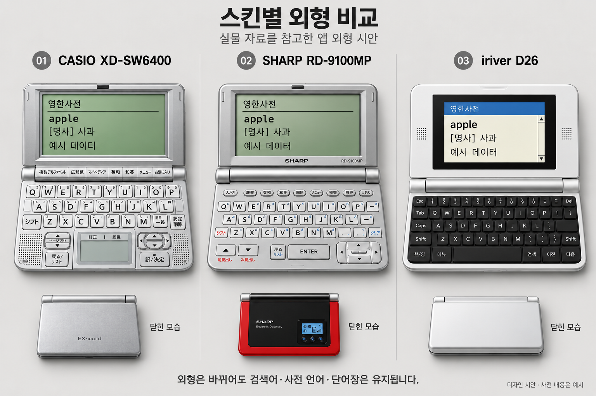
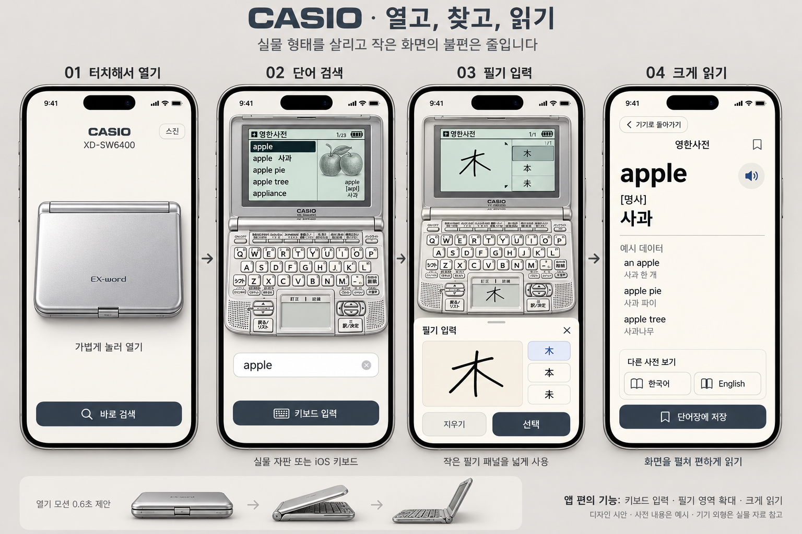
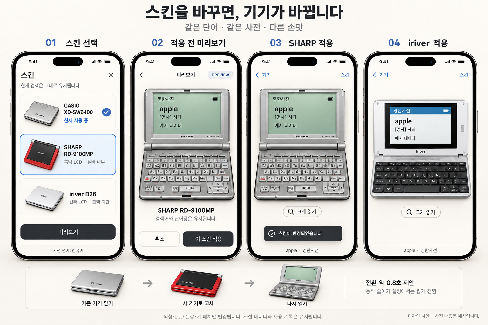

# 전자사전 앱 상세 시안

최신 피드백: 사용성 개선 과정에서도 실제 기기의 키 형태·배열을 유지해야 한다. 큰 버튼 6개로 대체한 안은 채택하지 않으며 [원형 키 유지 수정안](original-keys-revision.md)에서 LCD 공간 배분을 다시 제안한다.

작성일: 2026-10-01  
상태: 실물 자료를 참고한 정적 디자인 시안. 실행 가능한 iOS 앱이나 정밀 복제 도면은 아니다.

후속 사용성 검토: 사용자가 전체 본체 축소 방식의 작은 화면·버튼 문제를 지적했다. 이 문서의 이미지는 외형 참고로 보존하며 실사용 배치는 [사용성 수정안](usability-revision.md)과 [조작 가능한 비교 시안](usability-prototype.html)에서 다시 검토한다.

## 이번 시안의 기준

첫 기기는 CASIO XD-SW6400, 후속 스킨은 SHARP RD-9100MP와 iriver D26이다. 사전 중심으로 구성하며 MP3·영상·FM은 제외했다. 실제 사전 데이터 연결은 이후 구현 범위이며 이미지 속 단어와 뜻은 모두 화면 구성용 예시다.

시안에서 제안한 새 요소는 iOS 키보드 입력, 넓은 필기 입력창, 크게 읽기, 스킨 선택 화면이다. 원래 기기의 기능이라고 설명하지 않는다. 스킨 변경은 검색 언어 변경이나 사전 데이터 교체를 뜻하지 않는다.

## 1. 스킨별 열린 모습과 닫힌 모습

| 스킨 | 실물 자료에서 확인한 형태 | 시안에 반영한 기준 | 남은 보정 |
|---|---|---|---|
| CASIO XD-SW6400 | 실버 변형, 흑백 LCD, 하단 중앙 필기 패널, 좌측 페이지·뒤로 키, 우측 방향·결정 키 | 필기 패널을 중심으로 한 하단 구성을 보존 | 단축키 7개와 각 키 각인·간격은 설명서 기준으로 재제작 |
| SHARP RD-9100MP | 검정 덮개와 빨강 외곽, 외부 작은 표시창, 내부 은색, 원통형 힌지, 하단 우측 방향키 | 닫혔을 때와 열렸을 때의 색상 차이, 필기 패널 없는 구성 | 국내 기종의 한글 각인과 정확한 기능키 배치 보정 |
| iriver D26 | 가로로 긴 흰색·은색 몸체, 검정 화면 안쪽 테두리, 컬러 LCD, 노트북형 검정 자판 변형 | 다른 두 기기보다 가로형인 몸체와 컬러 사전 화면 | 고해상도 정면·덮개 자료로 비율, 힌지, 자판 세부 보정 |

이 비교판은 기기 특징을 비교하기 위해 크기를 조정한 이미지다. 세 제품의 실제 크기를 같은 축척으로 표현하지 않았다. D26의 덮개 세부는 자료가 부족해 단순화한 제안이다. SHARP 외부 표시창은 외형 참고이며 음악 기능이 구현되었다는 뜻이 아니다. 사전 상태를 표시하는 용도로 바꾸는 것은 별도 검토 대상으로 남긴다.

## 2. CASIO 사용 흐름

| 상태 | 화면과 동작 | 다음 상태 |
|---|---|---|
| 닫힘 | 실버 덮개, 열기 안내. 기기를 한 번 누르면 힌지 축으로 열린다. | 열림 |
| 바로 검색 | 닫힌 화면 하단에서 곧바로 검색으로 진입하는 편의 기능 제안. 반복 사용 대기를 줄인다. | 검색 입력 |
| 검색 입력 | 실물 키 또는 iOS 키보드로 입력한다. 두 입력 방식은 같은 검색어를 편집한다. | 결과 목록 |
| 결과 목록 | LCD의 반전 행으로 선택 위치를 표시한다. 방향키 또는 터치로 이동한다. | 뜻풀이 |
| 필기 입력 | 실제 하단 필기 패널을 누르면 넓은 입력창이 열린다. 후보를 고른 후 검색어에 넣는다. | 검색 입력 |
| 크게 읽기 | 선택한 표제어와 사전 출처를 큰 글씨로 보여준다. 발음과 단어장 저장에 접근한다. | 확대 뜻풀이 |
| 기기로 돌아가기 | 확대 전 검색어·사전·선택 결과·읽던 위치를 복원한다. | 본체 뜻풀이 |

이미지의 木 필기 화면은 별도의 입력 예시다. apple → 木 → apple로 자동 전환하는 연속 사용 흐름을 뜻하지 않는다. 실제 구현에서는 선택한 입력 언어와 사전 범위에 맞는 검색을 수행한다.

본체와 확대 화면은 동일한 항목을 표시한다. 확대 화면에만 임의의 추가 뜻을 생성하지 않는다. 한국어·English 버튼은 확보된 다른 사전을 열며, 번역을 생성하는 버튼이 아니다. 데이터가 없다면 사용 가능한 사전이 없음을 표시한다.

### 작은 자판의 조작 원칙

- 실제 모양의 키를 누르는 경험을 유지하되, 긴 단어 입력에는 시스템 키보드를 제공한다.
- CASIO의 작은 필기 패널은 입력창을 여는 진입점으로도 사용한다. 넓힌 영역에서 손가락으로 쓴다.
- 보이는 키에 동작을 연결한다. 이미지에서 키 각인이 뭉개진 부분을 그대로 앱 버튼으로 사용하지 않는다.
- 가로 기기를 세로 iPhone에 맞추려고 늘리지 않는다. 화면 폭에 맞춘 뒤 남는 공간에 편의 조작을 둔다.
- 키 크기·오입력률·한글 조합·일본어 변환은 실제 iPhone에서 별도 검증한다. 현재 시안은 터치 사용성 검증 결과가 아니다.

## 3. 스킨 선택과 적용

1. 본체 화면의 스킨 버튼을 누른다.
2. 목록에서 현재 사용 중인 기기에는 체크를 유지한다. 새로 고른 기기는 별도 선택 테두리로 표시한다.
3. 미리보기를 누르면 선택한 기기에서 현재 단어가 어떻게 보이는지 확인한다.
4. 취소하면 기존 스킨과 검색 상태로 돌아간다. 미리보기만으로 설정을 저장하지 않는다.
5. 이 스킨 적용을 누르면 기존 기기 닫기 → 외형 교체 → 새 기기 열기 순서로 전환한다.
6. 적용 완료 후 같은 단어와 사전을 계속 보여준다. 선택한 스킨은 다음 실행에도 유지한다.

| 바뀌는 것 | 유지하는 것 |
|---|---|
| 덮개·힌지·자판·키의 외형과 배치 | 검색어와 입력 언어 |
| LCD 색·질감·선택 표시의 시각적 스타일 | 사전 ID·항목 ID·뜻풀이 언어 |
| 기종별 확인된 버튼 소리와 눌림 표현 | 단어장·검색 기록·현재 선택 항목 |
| 기종별 지원하는 입력 장치의 모양 | 글자 크기·음소거·접근성 설정 |

화면 폭 차이 때문에 줄바꿈은 바뀔 수 있다. 읽던 위치는 문단이나 항목 기준으로 복원한다. 같은 픽셀 위치를 그대로 복사하지 않는다. 필기 입력 중에는 미리보기에서 내용을 지우지 않고, 입력창을 닫은 후 적용하는 규칙을 검토한다.

휴대폰 언어는 최초 추천에 사용한다. 일본어에는 CASIO, 한국어에는 SHARP를 초기 추천하는 방향이며 사용자가 언제든 D26 등을 고를 수 있다. 영어권의 역사적 대표 모델은 아직 정하지 않았으므로 CASIO를 공통 기본값으로 제안하되 영어권 대표라고 홍보하지 않는다. 사용자가 고른 스킨을 언어 변경 때 자동으로 덮어쓰지 않는다.

## 4. 재질·디스플레이·모션 지시

다음 수치는 실물 측정값이 아니라 초기 구현에서 비교할 제안값이다.

| 요소 | 제안 | 확인할 것 |
|---|---|---|
| 덮개 열기 | 약 0.6초, 실제 힌지 축을 따라 회전, 종점에서 감속 | 축 미끄러짐·본체 관통·과도한 튕김 없음 |
| 스킨 적용 | 약 0.8초 내 닫기·교체·열기 | 외형 전환 중 검색 상태 소실 없음 |
| 키 누름 | 터치 시 짧은 눌림, 놓으면 복귀. 필요 시 약한 햅틱 | 소리·시각 반응·입력 타이밍 일치 |
| LCD 켜짐 | 짧게 대비가 올라가는 표현 | 본문을 늦게 읽게 하는 긴 기동 연출 없음 |
| 흑백 LCD | 회녹색 반사형 바탕, 검은 도트 문자, 적은 채도 | 한글·한자 획과 선택 행 가독성 |
| 컬러 LCD | D26의 컬러 성격에 맞는 절제된 헤더와 밝은 본문 | 흑백 스킨의 구조를 임의로 재사용하지 않음 |
| 동작 줄이기 | 입체 개폐 대신 약 0.15초의 짧은 전환 제안 | 같은 최종 상태에 즉시 접근 |
| 앱 복귀 | 기존 열린 상태·검색 위치 복원 | 매번 덮개 열기를 강제하지 않음 |

CRT 주사선, 네온 녹색, 과한 글리치는 넣지 않는다. 숫자용 7세그먼트 글꼴로 사전 본문을 그리지 않는다. LCD 화면은 별도의 텍스트로 렌더링하고 사용자 글자 확대와 읽기 기능을 제공한다.

버튼 소리는 기종별 실물 녹음이나 사용 가능한 원음 자료가 필요하다. 이번 정적 이미지에는 음원이 없으며 원음 확보를 완료하지 않았다. 효과음 설정과 발음 재생은 구분한다.

## 5. 유지·제외·추후 결정

| 구분 | 기능 |
|---|---|
| 중심 기능 | 실제 사전 검색, 결과 선택, 뜻·품사·발음·출처, 단어장, 기록, 관련 표제어 이동 |
| 현대적 편의 | 데이터 갱신, 검수된 신조어, 키보드 입력, 크게 읽기, 스킨 교체 |
| 시안에서 제외 | MP3·음악 재생·영상·FM·멀티미디어 중심 홈 화면 |
| 초기 제외 제안 | 녹음기·전자책·PC 파일 연결 |
| 별도 결정 | 계산기·학습 퀴즈와 기존 출판사 콘텐츠의 포함 범위 |

기존 사전과 신조어는 출처를 구분한다. 실제 제품에는 데이터 판본·출처·확인일을 확인하는 경로를 두되, 예시 이미지의 apple 화면이 데이터 공급원을 확정한 것은 아니다.

## 6. 실제 제작에 넘길 자산과 남은 검증

- CASIO: 설명서의 키 배열을 바탕으로 키별 외형과 각인을 다시 제작한다. 생성 이미지에는 일부 왜곡된 문자와 키 수·간격 차이가 있어 정밀 도면으로 사용할 수 없다.
- SHARP: 한국어 키 각인, 원래 단축키와 앱 사전 기능의 대응을 확인한다. 시안 일부에 남은 일본어풍 키 문자는 교체 대상이다.
- D26: 열린 정면·닫힌 덮개·측면 자료를 보강한다. 현재 재질과 전체 형태는 참고 사진 기반이지만 세부 자판은 확정하지 않는다.
- 공통: 본체·덮개·키·LCD를 분리해 제작한다. 눌러야 하는 화면을 통째로 영상으로 만들지 않는다.
- Higgsfield: 이후 개폐 동작과 조명을 비교할 참고 영상이 필요하면 활용 가능하다. 이번에는 사용하지 않았고 토큰을 소비하지 않았다.
- 실제 사전 API·오프라인 데이터·발음 연결, 접근성, 키보드 입력, iOS 빌드는 아직 구현·검증하지 않았다.

## 7. 참고 자료와 생성 기록

참고 자료 확인일: 2026-10-01. 아래 자료는 시각 조사 기준이며 생성 이미지 자체는 제조사 자료가 아니다.

- [CASIO 공식 XD-SW6400 설명서](https://www.casio.com/content/dam/casio/global/support/manuals/exword/pdf/003-ja/comb/XD-SW6400_JA.pdf): 인쇄 22쪽 외형, 25쪽 키 배열. 로컬 PDF 페이지 24·27을 참고했다.
- [BCN의 XD-SW6400 보도 사진](https://www.bcnretail.com/news/detail/070621_7730.html): 색상과 열린 전체 형태.
- [SHARP RD-9100MP 제조사 배포 보도자료](https://www.newswire.co.kr/newsRead.php?no=222665): 검정·빨강 외부와 작은 외부 표시창.
- [RD-9100MP 사용자 실물 사진](https://dpg.danawa.com/mobile/community/view?boardSeq=28&listSeq=943735&past=YES): 열린 은색 내부, 힌지와 자판. 개인 리뷰는 외형 확인용이며 판매량 근거로 쓰지 않았다.
- [iriver D26 제조사 배포 보도자료](https://www.newswire.co.kr/newsRead.php?no=216092): 흰색·검정 변형과 가로형 몸체.

참고 이미지와 PDF는 로컬 references/에 보관했으며 공개 저장소에서는 재배포 권리 확인 전까지 제외한다. [참고 자료 안내](references/README.md)의 원문 링크로 확인할 수 있다. CASIO 설명서 PNG는 한글 경로 환경의 PDF 글꼴 문제로 일부 문자가 빠져 있어 원본 PDF를 기준으로 재확인해야 한다. 생성에는 키 배열 도형과 실제 제품 사진을 함께 사용했다.

[이미지 생성 지시문 및 수정 기록](generation-prompts.md)

