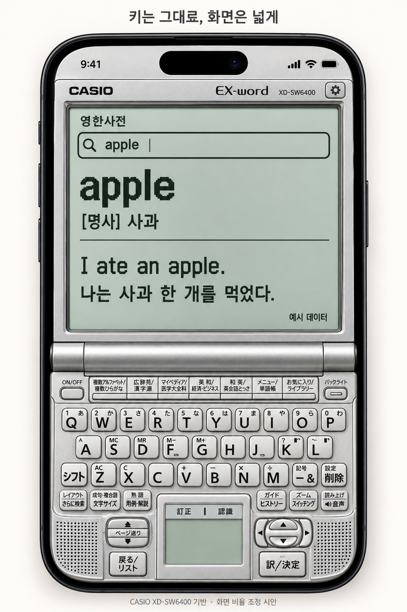

# 원형 키를 유지하는 수정 시안

2026-10-01. 사용자는 버튼 6개로 바꾼 사용성 시안이 당시 기기의 형태와 다르다고 지적했다. 해당 안은 채택하지 않는다.

## 유지할 기준

- CASIO XD-SW6400의 QWERTY 배열, 사전 단축키, 하단 중앙 필기 패널, 좌측 페이지·돌아가기 키, 우측 방향·결정 키의 형태와 상대적 배치를 유지한다.
- 큰 현대식 버튼 6개나 시스템 키보드로 원래 자판을 대체하지 않는다. 시스템 키보드는 선택적인 입력 보조다.
- 주변 빈 공간·두꺼운 이중 프레임·기울어진 원근 표현을 줄여 자판이 화면 폭을 최대한 사용하게 한다.
- LCD 영역을 세로로 늘리는 것은 이번 수정 제안이다. 키의 원형을 유지하는 사용자 요구와, 실제 기기 전체의 가로세로 비율을 변경하는 제안을 구분한다.
- 버튼을 늘어뜨리거나 배열을 단순화해 터치 크기를 맞추지 않는다. 여전히 작은 키가 남으므로 실제 조작 검증이 필요하다. 인접 키와 겹치는 터치 영역을 무작정 늘리지 않는다.

이전의 ‘10열이면 39폭 이하이므로 해결하기 어렵다’는 설명은 가능성을 너무 좁힌 판단이었다. 폭 계산만으로 입력 사용성을 결론낼 수 없다. 키 모양·간격·입력 보조·실제 오입력을 함께 확인해야 한다.

## 산출물 범위

이번 산출물은 공식 설명서의 키 배열 그림과 실물 사진을 참고해 imagegen으로 생성한 정적 수정 시안이다. 실제 클릭 가능한 자판, 필기 인식 또는 정밀 1:1 모델을 완성했다는 뜻이 아니다. 작은 키 각인·치수는 최종 제작에서 대조한다. 사전 내용은 예시다.

직전 usability-prototype.html은 폐기된 6버튼 배치의 비교 기록이며 최신 승인 디자인이 아니다. 이 이미지 역시 상세 배치 제안이며 사용자가 확정한 제품 설계로 취급하지 않는다.

[생성 지시문](original-keys-prompt.md)

