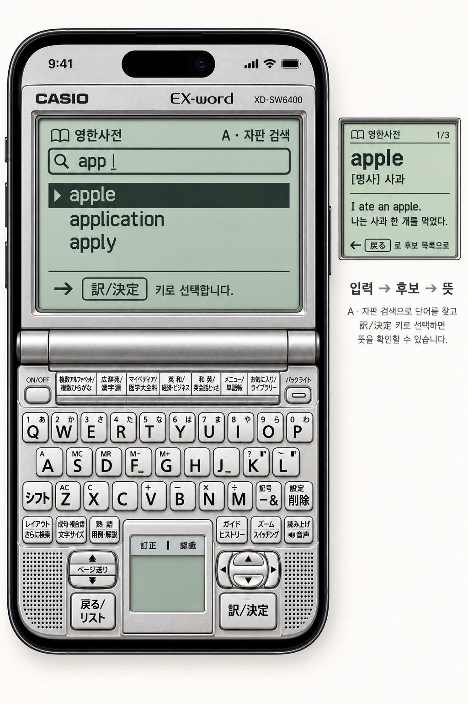
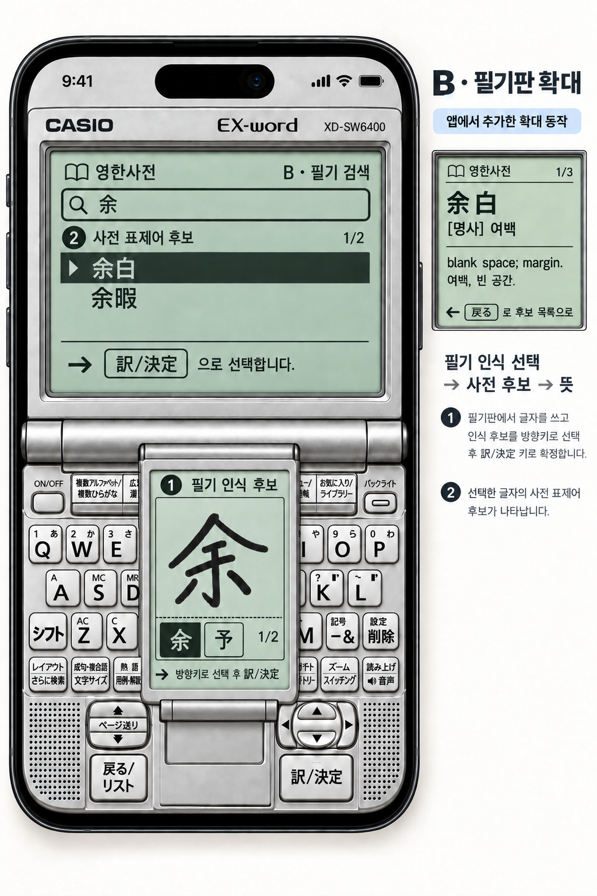

# CASIO 원형 조작 A/B 이미지 시안

2026-10-01 · [동작 제안](sol-interaction-proposal.md)을 이미지로 표현한 **토론용 예시**다. iOS 화면 구현, 실제 키 터치 성능, 사전 데이터 연결, 필기 인식 성능을 검증한 결과가 아니다. 기본 내장 image_gen으로 제작했으며 원형 키와 본체 참고 자료는 [키 배열 도면](references/casio-keys.png), [본체 도면](references/casio-body.png), [실물 사진](references/casio-sw6400-bcn.jpg)이다. 기존 [원형 키 시안](05-original-keys-expanded-lcd.png)도 화면 질감·크롭 참고로 사용했다.

## A — 원형 자판 작업면 집중

원형 전용키, QWERTY 첫 행 10키·둘째 행 9키, 하단 Shift/삭제, 중앙의 작은 필기판, 좌측 페이지·뒤로, 우측 방향·독립 결정키를 유지한다. LCD에는 `app` 입력에 따른 예시 표제어 후보와 반전 선택을, 우측 작은 인셋에는 같은 LCD에서 이어지는 `apple` 뜻풀이를 보여준다. 이는 **부분 입력→실제 사전 후보 선택→뜻**의 시각적 흐름이며, 이미지의 사전 텍스트는 예시다.

**생성 지시 요약:** “iPhone 세로 화면에 열려 있는 실버 CASIO XD-SW6400을 정면으로 가득 배치한다. 제공한 키 도면을 정확한 배열 기준으로 삼아 원형 키·중앙 필기판·좌우 조작키를 보존한다. 회녹색 LCD는 `app` 검색 후보 `apple/application/apply`와 반전 선택을 표시하고, 보조 LCD 인셋에 `apple` 뜻풀이를 표시한다. 주변 장식만 줄이며 6버튼·일반 시스템 키보드로 대체하지 않는다.”

## B — 중앙 필기판 확대

중앙의 원래 작은 필기판에서 확대 면이 위로 펼쳐져 문자 키 중앙을 **일시적으로** 가린다. 양측 원형 키와 좌측 페이지·뒤로, 우측 방향·독립 결정키는 원위치에 드러난다. 확대 면의 `余/予`는 **필기 인식 후보**, 본체 LCD의 `余白/余暇`는 다음 단계의 **사전 표제어 후보**다. 작은 뜻풀이 인셋은 그다음 화면을 뜻한다. 이 필기판 확대는 원기기 기능의 복제가 아니라 앱에서 새로 제안한 동작이다.

**생성 지시 요약:** “A와 같은 iPhone·CASIO 본체와 실제 키캡을 유지한다. 중앙 필기판만 위로 펼쳐 한자 `余`를 쓰는 공간을 만든다. 패널 안에는 1단계 필기 인식 후보 `余/予`, LCD에는 2단계 사전 후보 `余白/余暇`, 작은 인셋에는 같은 LCD의 뜻을 둔다. 원래 우측 방향·결정키와 좌측 조작키를 가리지 않는다. 앱이 추가한 확대 동작이라고 표기한다.” 1차 결과의 LCD 상단 `A · 자판 검색`을 `B · 필기 검색`으로 교정했다.

**남은 검증:** 키 각인의 세부 정확도는 설명서와 다시 대조해야 한다. 특히 iPhone에서 문자 키의 **가로 폭은 이 그림만으로 개선되지 않는다**. 실제 탭 오류, 한글·일본어 입력 방식, 필기 인식 정확도, 한 손 사용·접근성·반복 피로는 동작 시안으로 확인해야 한다.
